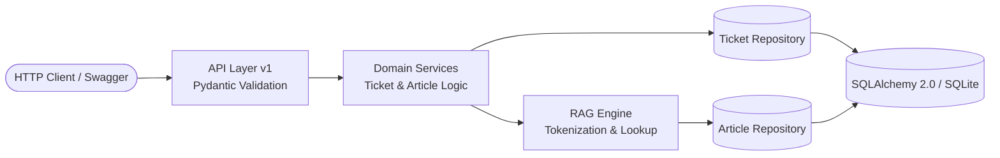

# Smart Support API

**Service Desk Backend & Contextual Incident Triage Engine (RAG)**

---

## Contexto e Motivação

Operações de suporte técnico N1/N2 frequentemente sofrem com gargalos de triagem: incidentes recorrentes chegam sem diagnóstico preliminar, exigindo que analistas busquem manualmente procedimentos já documentados antes de iniciar a resolução.

A **Smart Support API** resolve esse problema acoplando um pipeline de **RAG (Retrieval-Augmented Generation)** diretamente ao fluxo de ingestão de tickets. No momento em que um chamado é criado, o motor analisa o payload, cruza termos relevantes contra a Base de Conhecimento interna e anexa recomendações técnicas ao registro antes mesmo da fila de atendimento humano.

---

## Arquitetura do Sistema

O projeto segue uma **Arquitetura em Camadas** combinada ao **Repository Pattern**, mantendo regras de domínio isoladas de detalhes de transporte HTTP e persistência relacional.

### Decisões de Projeto
* **Isolamento de Persistência:** Nenhuma camada de roteamento ou serviço executa queries diretamente. O acesso a dados passa exclusivamente pelos repositórios, viabilizando a troca de SQLite para PostgreSQL sem impacto nas regras de negócio.
* **Separação de Contratos:** Entidades ORM (`app/models`) são estritamente desacopladas dos contratos de entrada e saída (`app/schemas`), evitando *over-posting* e vazamento de atributos internos.
* **Gerenciamento Determinístico de Sessão:** Sessões de banco são injetadas por requisição via gerador (`Depends(get_db)`), assegurando rollback e fechamento limpo em caso de falhas.

---

## Estrutura do Projeto

    smart-support-api/
    ├── app/
    │   ├── api/v1/              # Endpoints REST (/tickets, /articles) e roteador versionado
    │   ├── core/                # Configurações de ambiente via Pydantic Settings
    │   ├── database/            # Configuração do Engine, SessionLocal e Base declarativa
    │   ├── models/              # Entidades relacionais (Ticket, KnowledgeArticle)
    │   ├── repositories/        # Operações CRUD e consultas encapsuladas
    │   ├── schemas/             # Contratos DTO (Create, Update, Response)
    │   ├── services/            # Orquestração de domínio e motor de sugestão RAG
    │   └── main.py              # Instância FastAPI e metadados OpenAPI
    ├── tests/
    │   └── test_api.py          # Testes de integração com banco isolado (Pytest)
    ├── .env.example             # Template de variáveis de ambiente
    ├── .gitignore               # Exclusão de artefatos locais e banco de dados
    ├── requirements.txt         # Dependências fixadas
    └── README.md

---

## Modelagem de Dados

### `tickets`
| Coluna | Tipo | Restrições | Descrição |
| :--- | :--- | :--- | :--- |
| `id` | `Integer` | `PK, Auto-increment` | Identificador único do chamado |
| `title` | `String(200)` | `Not Null, Indexed` | Resumo objetivo do incidente |
| `description` | `Text` | `Not Null` | Detalhamento técnico do problema |
| `category` | `String(100)` | `Default: "Geral"` | Domínio técnico (`Redes`, `Acessos`, etc.) |
| `priority` | `String(20)` | `low \| medium \| high \| critical` | Criticidade operacional |
| `status` | `String(20)` | `open \| in_progress \| resolved \| closed` | Estado atual no ciclo de atendimento |
| `suggested_solution` | `Text` | `Nullable` | Sugestão anexada pelo motor RAG na criação |
| `created_at` | `DateTime` | `UTC Now` | Timestamp de abertura |
| `updated_at` | `DateTime` | `UTC Now (On Update)` | Timestamp da última atualização |

### `knowledge_articles`
| Coluna | Tipo | Restrições | Descrição |
| :--- | :--- | :--- | :--- |
| `id` | `Integer` | `PK, Auto-increment` | Identificador único do artigo |
| `title` | `String(200)` | `Not Null, Indexed` | Título do procedimento operacional (POP) |
| `content` | `Text` | `Not Null` | Instruções técnicas de resolução |
| `category` | `String(100)` | `Default: "Geral"` | Área técnica associada |
| `tags` | `String(255)` | `Nullable` | Palavras-chave para indexação e busca |
| `created_at` | `DateTime` | `UTC Now` | Timestamp de publicação |

---

## Endpoints (`/api/v1`)

| Método | Rota | Descrição | Status HTTP |
| :--- | :--- | :--- | :--- |
| `GET` | `/health` | Healthcheck de disponibilidade e versão da API | `200` |
| `POST` | `/api/v1/articles/` | Indexa um novo artigo técnico na Base de Conhecimento | `201`, `422` |
| `GET` | `/api/v1/articles/` | Lista procedimentos cadastrados (`skip`, `limit`) | `200` |
| `POST` | `/api/v1/tickets/` | Abre um chamado e aciona o pipeline RAG automaticamente | `201`, `422` |
| `GET` | `/api/v1/tickets/` | Lista chamados com paginação e filtro (`?status=open`) | `200` |
| `GET` | `/api/v1/tickets/{ticket_id}` | Busca detalhes de um chamado específico | `200`, `404` |
| `PATCH` | `/api/v1/tickets/{ticket_id}` | Atualização parcial de status, prioridade ou descrição | `200`, `404`, `422` |
| `DELETE` | `/api/v1/tickets/{ticket_id}` | Remove um chamado da base de dados | `204`, `404` |

---

## Exemplos de Uso

### 1. Registrar Procedimento Técnico (`POST /api/v1/articles/`)

    curl -X POST "http://127.0.0.1:8000/api/v1/articles/" \
      -H "Content-Type: application/json" \
      -d '{
        "title": "Falha de autenticação na VPN Corporativa",
        "content": "Validar sincronização do token MFA e reiniciar o cliente FortiClient. Persistindo, executar ipconfig /flushdns.",
        "category": "Redes",
        "tags": "vpn, forticlient, mfa, rede"
      }'

### 2. Abrir Chamado com Sugestão Automática (`POST /api/v1/tickets/`)

    curl -X POST "http://127.0.0.1:8000/api/v1/tickets/" \
      -H "Content-Type: application/json" \
      -d '{
        "title": "Erro ao conectar na VPN",
        "description": "O cliente FortiClient falha ao autenticar na rede corporativa.",
        "category": "Redes",
        "priority": "high"
      }'

**Payload de Resposta (`201 Created`):**

    {
      "title": "Erro ao conectar na VPN",
      "description": "O cliente FortiClient falha ao autenticar na rede corporativa.",
      "category": "Redes",
      "priority": "high",
      "id": 1,
      "status": "open",
      "suggested_solution": "Sugestões encontradas na Base de Conhecimento:\n\n1. [Redes] Falha de autenticação na VPN Corporativa: Validar sincronização do token MFA e reiniciar o cliente FortiClient. Persistindo, executar ipconfig /flushdns.",
      "created_at": "2026-11-24T18:26:33.795147",
      "updated_at": "2026-11-24T18:26:33.795158"
    }

---

## Execução Local e Testes

### Inicialização do Ambiente

    git clone https://github.com/seu-usuario/smart-support-api.git
    cd smart-support-api

    python3 -m venv .venv
    source .venv/bin/activate

    pip install -r requirements.txt
    cp .env.example .env

    uvicorn app.main:app --reload

* **Swagger UI:** `http://127.0.0.1:8000/docs`
* **ReDoc:** `http://127.0.0.1:8000/redoc`

### Suíte de Testes (`Pytest`)

Os testes de integração utilizam `dependency_overrides` para redirecionar a sessão do SQLAlchemy a um banco SQLite temporário, validando endpoints e o fluxo RAG sem alterar dados locais:

    pytest -v

---

## Próximos Passos

* [ ] **Busca Semântica Vetorial:** Substituir a busca léxica por embeddings densos (`sentence-transformers` + `pgvector`).
* [ ] **Autenticação & Controle de Acesso:** Implementar OAuth2 com JWT e perfis (`requester`, `agent`, `admin`).
* [ ] **Containerização:** Adicionar `Dockerfile` multi-stage e `docker-compose.yml` com PostgreSQL.
* [ ] **Eventos & Webhooks:** Disparar notificações assíncronas (Slack, Teams, n8n) para incidentes `critical`.

---

 <em> Documentação elaborada com auxílio de IA </em>.

